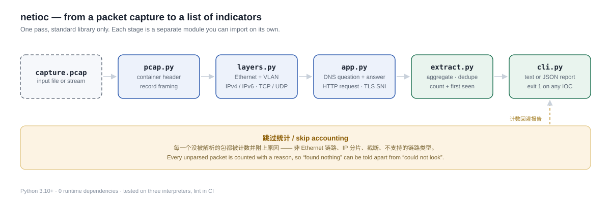

# netioc

> 从一个 pcap 里把 IOC 抠出来：DNS 域名、HTTP Host/URI、TLS SNI、外部 IP。**零第三方依赖。**

Pull indicators of compromise out of a packet capture — DNS names, HTTP hosts and URIs, TLS SNI, external addresses — with nothing but the standard library.

[](https://github.com/RicardoMLu777/netioc/actions/workflows/tests.yml)
[](https://www.python.org/)
[](pyproject.toml)
[](LICENSE)
[](netioc/)



---

## 为什么会有这个工具

应急响应和流量分析里，最常被问的问题是"这台机器连过谁"。回答它不需要完整的协议栈解析，也不需要装 scapy、pyshark、tshark。

但现有工具都是重装备：`pyshark` 要 Wireshark 运行时，`scapy` 会带进一串依赖。如果你只想在一个 IR 脚本里加三行、或者在一个 CI job 里判断"这段样本有没有外联"，代价太大。

netioc 的定位是**可嵌入**，不是替代 Wireshark：

- 纯标准库，`pip install netioc` 之后没有任何额外依赖
- 也可以直接把 `netioc/` 目录拷进你的项目，不用装
- 输出是结构化的 dict，方便接你的下游逻辑
- `--fail-on-ioc` 可以直接当 CI 门禁用

## 安装

```bash
pip install netioc
```

或者不装，直接跑：

```bash
git clone https://github.com/RicardoMLu777/netioc.git
cd netioc
python -m netioc.cli capture.pcap
```

Python 3.10+。

## 用法

```bash
netioc capture.pcap
```

```
netioc 0.1.0  capture.pcap
  packets 7  decoded 7  skipped 0  tcp 5  udp 2

DNS queries (1)
  update.evil-c2.example  x1    A       first seen +0.000s

DNS answers (1)
  93.184.216.34           x1    A       first seen +1.001s

HTTP hosts (1)
  update.evil-c2.example  x3            first seen +2.002s

HTTP URIs (3)
  /gate.php?id=0          x1            first seen +2.002s
  /gate.php?id=1          x1            first seen +3.003s
  /gate.php?id=2          x1            first seen +4.004s

TLS SNI (1)
  beacon.evil-c2.example  x1            first seen +5.005s

External IPs (2)
  93.184.216.34           x4            first seen +2.002s
  8.8.8.8                 x2            first seen +0.000s
```

### 常用选项

```bash
# JSON 输出，接你的流水线
netioc capture.pcap --json

# 只看 DNS 和 TLS
netioc capture.pcap --only dns,tls

# 只报告出现 3 次以上的（过滤背景噪声）
netioc capture.pcap --min-count 3

# CI 门禁：发现任何 IOC 就退出码 1
netioc capture.pcap --fail-on-ioc
```

### 当库用

```python
from netioc import analyse_file

report = analyse_file("capture.pcap")
for name in report.dns_queries:
    print(name, report.dns_queries[name].count)

print(report.as_dict())  # 完整结果，可直接 json.dumps
```

## 能提取什么

| 类别 | 来源 | 说明 |
|---|---|---|
| `dns_queries` | UDP 53 | 查询的域名 + 记录类型（A/AAAA/CNAME/MX…） |
| `dns_answers` | UDP 53 | 应答里的 A / AAAA / CNAME 值 |
| `http_hosts` | TCP 80/8080/8000/8888 | 请求头里的 `Host` |
| `http_uris` | 同上 | 请求行里的路径 |
| `tls_sni` | TCP 443/8443 | ClientHello 里的 server_name |
| `external_ips` | IPv4 / IPv6 | 非私网、非环回、非链路本地、非组播的地址 |

每条命中都带 `first_seen`（相对第一个包的秒数）和 `count`。IR 场景里"什么时候第一次出现"往往比"出现了几次"更重要。

链路层支持 Ethernet（含最多两层 VLAN 标签）、raw IP、Linux cooked。

## 明确不支持的

写清楚边界，比假装全能有用：

- **pcapng** —— 现代 tcpdump / Wireshark 的默认格式。会直接报错并提示 `editcap -F pcap in.pcapng out.pcap`
- **TCP 流重组** —— 请求头如果跨了多个 TCP 段，就看不全。单段内能解析的（绝大多数请求头）没问题
- **HTTP/2 与 QUIC** —— 前者是二进制帧，后者 UDP 加密，都看不到明文 Host
- **IPv6 扩展头** —— 只解第一个 Next Header 就是 TCP/UDP 的情况，遇到扩展头会记为 skipped
- **IP 分片** —— 不重组，分片包记为 skipped
- **加密流量的内容** —— 只能看到 SNI，看不到后面的 HTTP
- **DoH / DoT** —— 走 443/853 的 DNS 在 netioc 眼里就是普通 TLS

跳过的包不会被静默吞掉：`skipped` 计数和 `skip_reasons` 会告诉你为什么，避免把"没找到"和"没看"混为一谈。

## 一些设计取舍

**为什么手写解析而不是用 scapy。** pcap 的容器格式是 24 字节全局头 + 若干条 `(16 字节头 + 数据)`，所有字段都是定宽整数，用 `struct` 解十几行就够。为了这个引入一个依赖，等于让每个使用者的供应链都多一个可变项。

**为什么解析要区分"跳过"和"没找到"。** 安全工具最坏的失败模式是静默地什么都没报，让人误以为干净。所以 `skip_reasons` 是输出的一部分，不是日志。

**`external_ips` 用 `ipaddress` 判断。** 注意 Python 3.13 起 `is_private` 对文档保留地址也会返回 True——`203.0.113.10`、`2001:db8::1` 这类地址不会被当成外部 IP。这对真实流量没影响（没人拿 TEST-NET 做 C2），但你写测试时得用真实公网地址，否则会困惑。

## 测试

```bash
pip install -e ".[dev]"
pytest -q
```

36 个用例。测试自己构造 pcap 字节（`tests/helpers.py`），不提交二进制 fixture——这样每个包的内容在 code review 里是可见的，也不用维护一堆没人敢动的 blob。

## License

MIT
